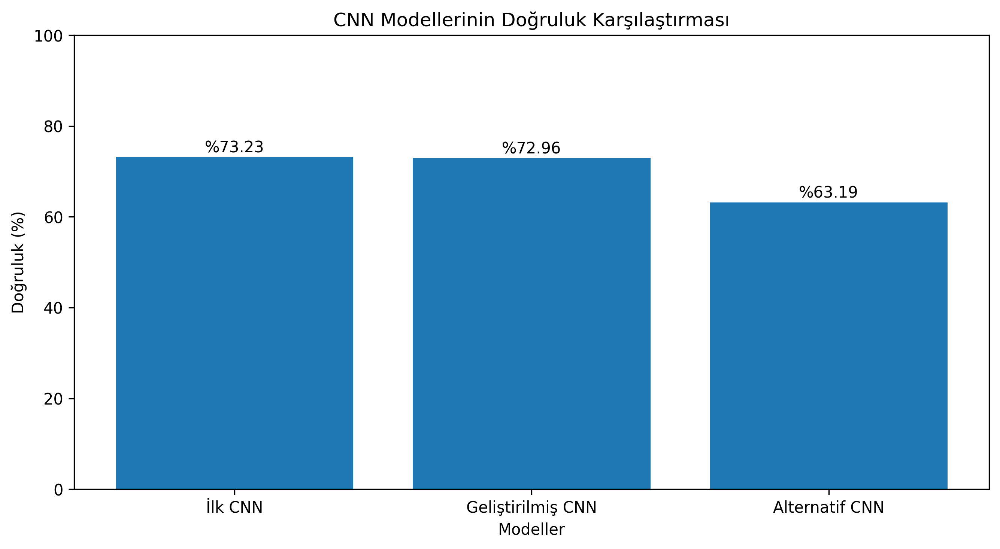
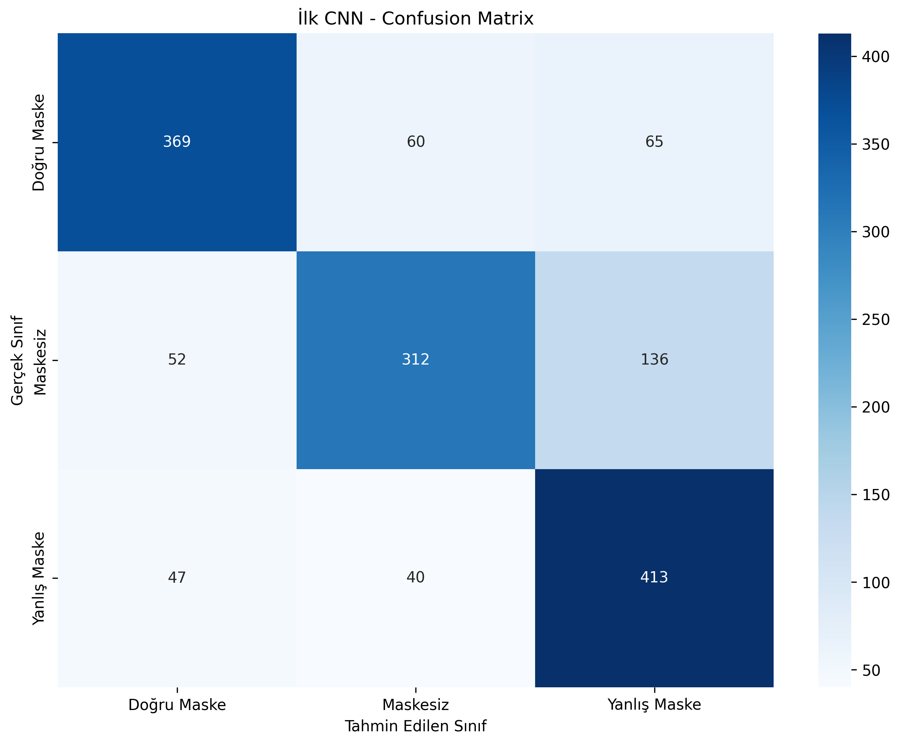

# CNN ile Yüz Maskesi Tespiti

## Proje Hakkında

Bu projede, Evrişimsel Sinir Ağları (CNN) kullanılarak yüz görüntüleri üç sınıfa ayrılmıştır:

- **Doğru Maske:** Maskenin burun ve ağzı doğru şekilde kapattığı durumlar.
- **Maskesiz:** Yüzde maske bulunmayan durumlar.
- **Yanlış Maske:** Maskenin yanlış takıldığı durumlar.

Projenin amacı, farklı CNN mimarilerini deneyerek yüz maskesi sınıflandırma performanslarını incelemek ve karşılaştırmaktır.

## Veri Seti

Veri seti toplam 4.478 görüntüden oluşmaktadır.

| Sınıf | Eğitim | Değerlendirme | Toplam |
|---|---:|---:|---:|
| Doğru Maske | 1.000 | 494 | 1.494 |
| Maskesiz | 1.000 | 500 | 1.500 |
| Yanlış Maske | 984 | 500 | 1.484 |
| **Toplam** | **2.984** | **1.494** | **4.478** |

Sınıf etiketleri:
- `dogru_maske`
- `maskesiz`
- `yanlis_maske`

## Kullanılan Yöntemler

### Veri Ön İşleme

- Görüntüler 128 × 128 piksel boyutuna getirilmiştir.
- Piksel değerleri 1/255 ölçeklendirmesiyle normalize edilmiştir.
- Eğitim verilerinde görüntü artırma (data augmentation) uygulanmıştır:
  - 15 derece döndürme
  - 0.1 zoom
  - Yatay çevirme

### CNN Modelleri

Projede üç CNN modeli eğitilmiş ve değerlendirilmiştir:

1. İlk CNN Modeli
2. Geliştirilmiş CNN Modeli
3. Alternatif CNN Modeli

Ek olarak Mixed Precision ve TensorFlow veri pipeline optimizasyonları kullanan dördüncü bir deneysel model tasarlanmıştır. Ancak eğitim çıktıları eksik olduğundan performansı doğrulanamamıştır.

## Model Performanslarının Karşılaştırılması

| Model | Doğruluk | Kayıp |
|---|---:|---:|
| İlk CNN | %73,23 | 1,1903 |
| Geliştirilmiş CNN | %72,96 | 1,4936 |
| Alternatif CNN | %63,19 | 0,8923 |

### Model Karşılaştırma Grafiği

## Detaylı Performans Analizi

İlk CNN modeli için elde edilen sınıf bazlı sonuçlar:

| Sınıf | Precision | Recall | F1-Score |
|---|---:|---:|---:|
| Doğru Maske | 0,7885 | 0,7470 | 0,7672 |
| Maskesiz | 0,7573 | 0,6240 | 0,6842 |
| Yanlış Maske | 0,6726 | 0,8260 | 0,7415 |
| **Genel doğruluk** | | | **0,7323** |

### Confusion Matrix

Sonuçlar, modelin yanlış maske sınıfını yakalamada daha başarılı olduğunu; maskesiz sınıfında ise daha fazla karışıklık yaşadığını göstermektedir.

## Kullanılan Teknolojiler

- Python
- TensorFlow
- Keras
- NumPy
- OpenCV
- Matplotlib
- Pillow
- Google Colab

## Projenin Sınırlılıkları

- Değerlendirme veri seti eğitim sırasında doğrulama (`validation_data`) amacıyla da kullanılmıştır. Bu nedenle sonuçlar tamamen bağımsız bir test performansı olarak değerlendirilmemelidir.
- Modellerin doğruluk oranları veri setinin kapsamı ve çeşitliliğiyle sınırlıdır.
- Dördüncü deneysel modelin eğitim sonuçları doğrulanamamıştır.

## Gelecekte Yapılabilecek İyileştirmeler

- Eğitim, doğrulama ve test verilerinin birbirinden bağımsız ayrılması.
- Daha geniş ve çeşitli bir veri setiyle eğitim yapılması.
- Hiperparametre optimizasyonu.
- Transfer learning yöntemlerinin denenmesi.
- Sınıf bazlı performansın iyileştirilmesi.

## Sonuç

Bu projede üç farklı CNN mimarisi uygulanmış ve sonuçları karşılaştırılmıştır. Elde edilen sonuçlarda ilk CNN modeli %73,23 doğruluk oranıyla en yüksek performansı göstermiştir.

Proje, görüntü sınıflandırma, CNN mimarileri, veri ön işleme ve model değerlendirme süreçlerine yönelik uygulamalı bir çalışma niteliğindedir.
